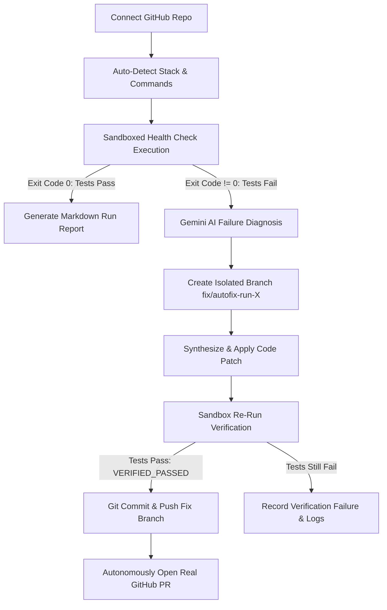

# AutoMaintain - AI Autonomous Software Maintenance Platform 🚀

[](https://www.oracle.com/java/)
[](https://spring.io/projects/spring-boot)
[](https://nextjs.org/)
[](https://tailwindcss.com/)
[](https://ai.google.dev/)
[](https://opensource.org/licenses/MIT)

**AutoMaintain** is an intelligent, zero-touch software maintenance platform designed to autonomously monitor code repositories, detect build/test failures in isolated sandboxes, diagnose root causes with Gemini AI, synthesize verified code patches, and open real GitHub Pull Requests—all without touching production branches.

---

## 🏗 End-to-End Autonomous Workflow



---

## ✨ Core Features (v1 Release)

- 🔒 **Multi-Tenant Workspace Security (FR-01)**: Role-based workspace isolation and secure JWT authentication.
- ⚡ **Seamless GitHub Integration (FR-02)**: Authenticated GitHub REST API integration with 5,000 req/hr rate limits.
- 🔍 **Zero-Config Project Detection (FR-03)**: Automatically detects Java (Maven/Gradle), Node.js (`package.json`), and Python (`requirements.txt`).
- 🛡 **Sandboxed Execution Engine (FR-04)**: Isolated process runner with stdout/stderr capture, secret redaction (`[REDACTED_SECRET]`), and execution timeouts.
- ⏰ **Automated Health Monitoring (FR-05)**: Daily background cron scheduler (`02:00 AM`) for continuous repository monitoring.
- 🤖 **Gemini AI Failure Diagnosis (FR-06)**: Extracts failure summaries, error snippets, confirmed facts vs hypotheses, and actionable remediations.
- 🩹 **Autonomous Bug Remediation (FR-07)**: Synthesizes code fixes in isolated branches and verifies fixes in sandbox before any push.
- 🚀 **Zero-Touch GitHub Pull Requests (FR-08)**: Automatically pushes verified fix branches and opens real GitHub PRs with markdown changelogs.
- 📊 **Audit Reports & Unified Diff (FR-09)**: Real-time execution logs, downloadable/copyable Markdown reports, and colorized syntax diffs (`+`/`-`).
- 🎨 **Modern Gradient UI**: Obsidian dark glassmorphism theme with ambient glows, live radar status indicators, and 100% mobile-responsive layout.

---

## 🛠 Tech Stack

- **Backend**: Java 17, Spring Boot 3, Spring Data JPA, Spring Security, JWT, Jackson, RestTemplate, H2 (embedded) / PostgreSQL.
- **Frontend**: Next.js 14 (App Router), TypeScript, Tailwind CSS, Lucide React, Glassmorphism CSS.
- **AI Engine**: Google Gemini 1.5 Flash with fallback rule-based diagnostic engine.
- **VCS Integration**: Git CLI & GitHub REST API v3.

---

## 📁 Repository Structure

```text
automation/
├── backend/                             # Java 17 / Spring Boot API
│   ├── src/main/java/com/platform/maintenance/
│   │   ├── auth/                        # JWT & User security
│   │   ├── config/                      # CORS & Security filters
│   │   ├── controller/                  # REST API controllers
│   │   ├── model/                       # JPA entities (Job, Repo, FixAttempt)
│   │   └── service/                     # AI Fix, Execution & Detection services
│   ├── src/main/resources/
│   │   ├── application.yml              # Base Spring configuration
│   │   └── application-local.yml.example # Local secrets template (git-ignored)
│   └── pom.xml
├── frontend/                            # Next.js 14 Web Application
│   ├── src/app/                         # App Router (dashboard, login, layout)
│   ├── src/lib/api.ts                   # Type-safe API client
│   ├── .env.example                     # Frontend environment template
│   └── package.json
├── docker-compose.yml                   # Containerized deployment setup
├── AI_Autonomous_Software_Platform_Requirements.md # PRD & specs
└── README.md
```

---

## 🚀 Getting Started

### Prerequisites
- **Java 17+** (JDK 17)
- **Maven 3.8+**
- **Node.js 18+** & `npm`
- **Git CLI** configured in system PATH

---

### Step 1: Clone & Configure Secrets

```bash
git clone https://github.com/YOUR_USERNAME/automation.git
cd automation
```

#### Backend Secret Configuration:
Copy the example config to `application-local.yml` (this file is git-ignored for security):
```bash
cp backend/src/main/resources/application-local.yml.example backend/src/main/resources/application-local.yml
```
Fill in your credentials in `application-local.yml`:
```yaml
app:
  ai:
    api-key: "YOUR_GEMINI_API_KEY"
  github:
    token: "YOUR_GITHUB_PERSONAL_ACCESS_TOKEN" # Needs 'repo' scope
```

#### Frontend Secret Configuration:
```bash
cp frontend/.env.example frontend/.env.local
```

---

### Step 2: Run the Platform

#### Terminal 1 — Start Backend Server:
```bash
cd backend
mvn spring-boot:run
```
- API Base URL: `http://localhost:8080/api`
- Embedded H2 Database Console: `http://localhost:8080/api/h2-console`

#### Terminal 2 — Start Frontend Dashboard:
```bash
cd frontend
npm install
npm run dev
```
- Open `http://localhost:3000` in your browser.

---

### Step 3: Run Automated Backend Tests

```bash
cd backend
mvn test
```
*Validated test suites:*
- `ProjectDetectorServiceTest`: Validates detection across Java Maven and Node.js projects.
- `ExecutionEngineServiceTest`: Verifies isolated execution and automated secret redaction.
- `ReportServiceTest`: Validates Markdown report generation.

---

## 🐳 Docker Compose (Optional)

To spin up the entire platform with containerized PostgreSQL:
```bash
docker-compose up --build
```

---

## 📄 License

This project is licensed under the [MIT License](LICENSE).
